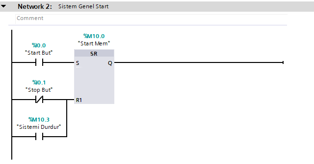
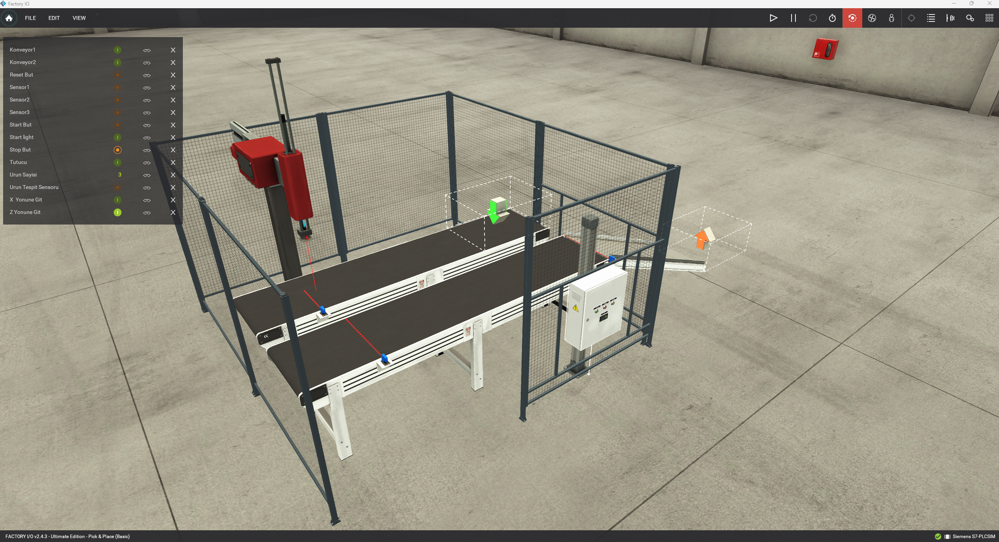
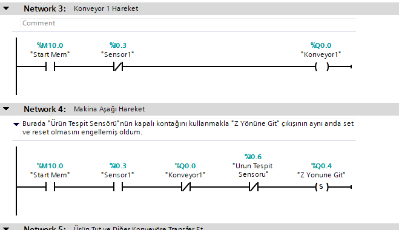
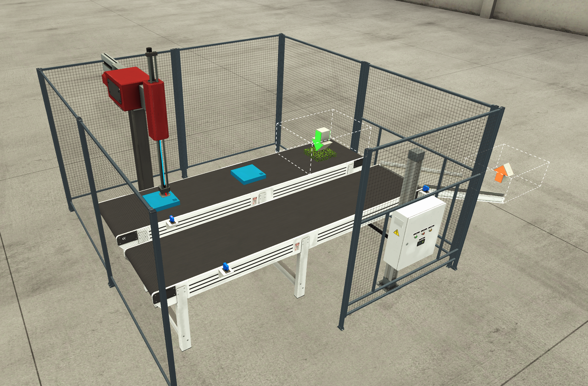
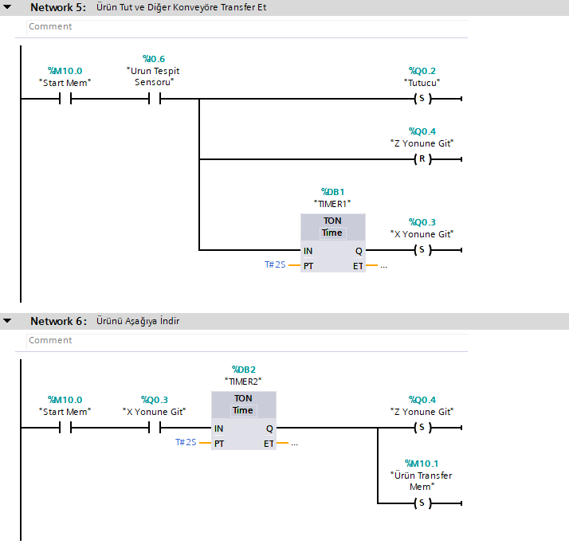
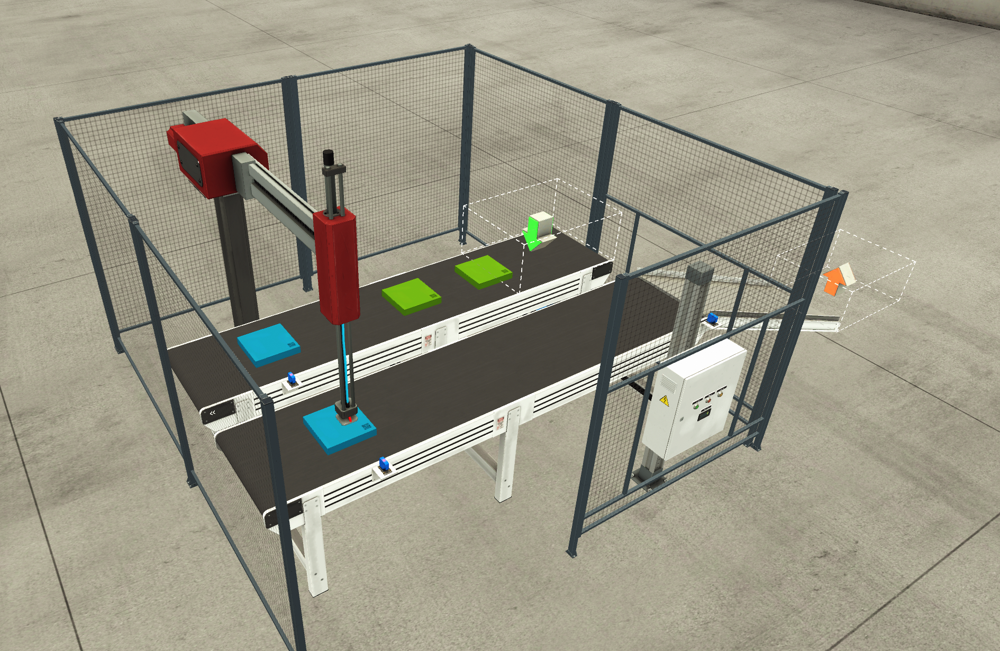
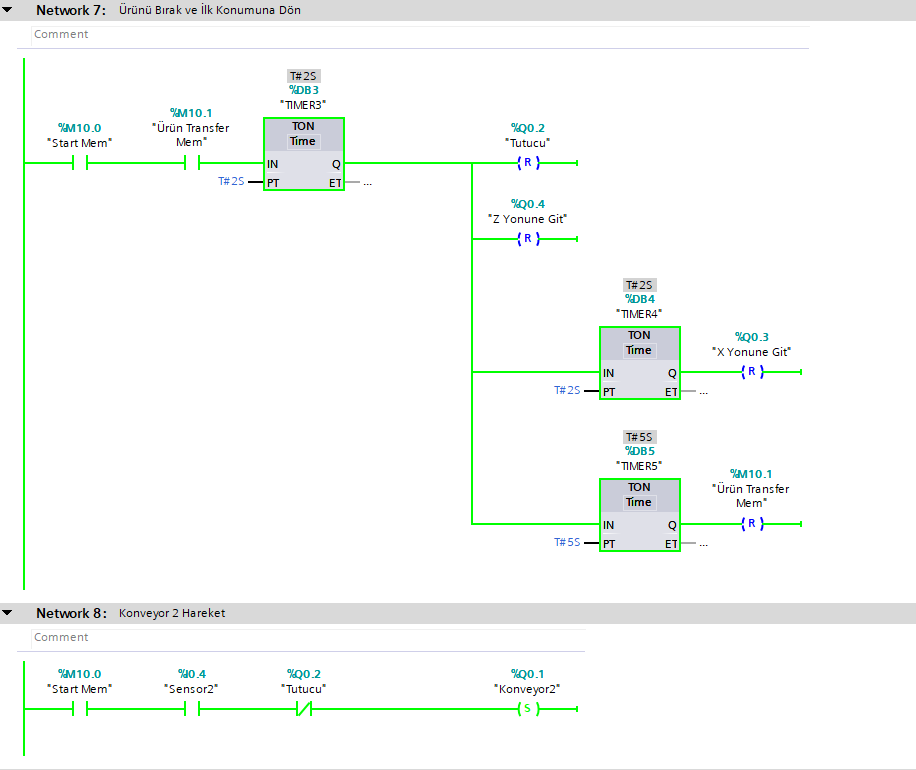
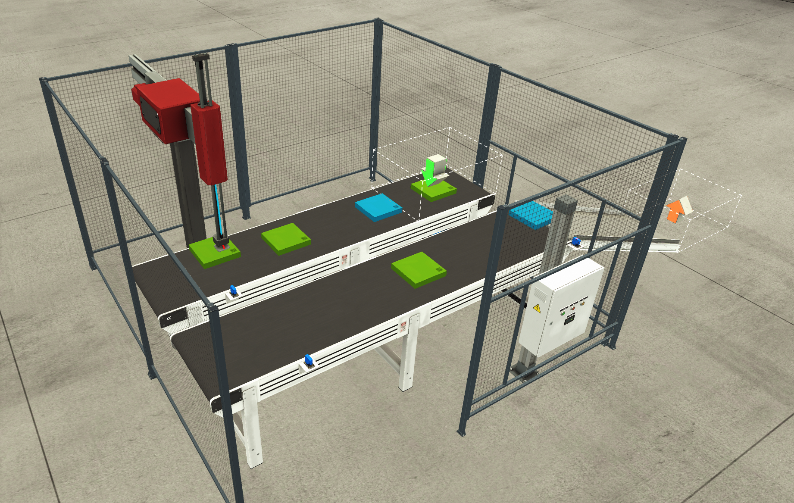
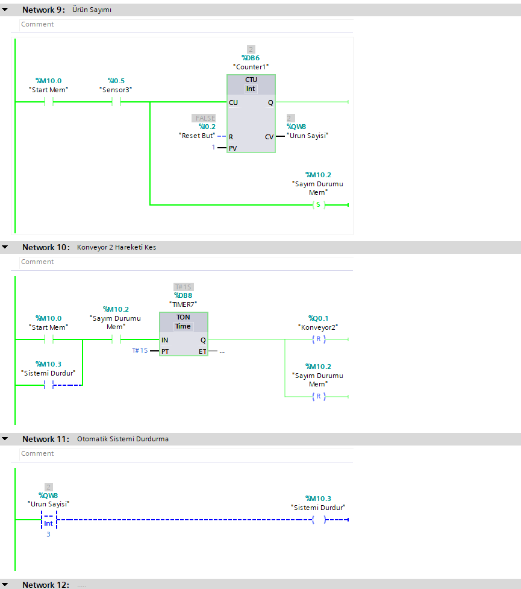
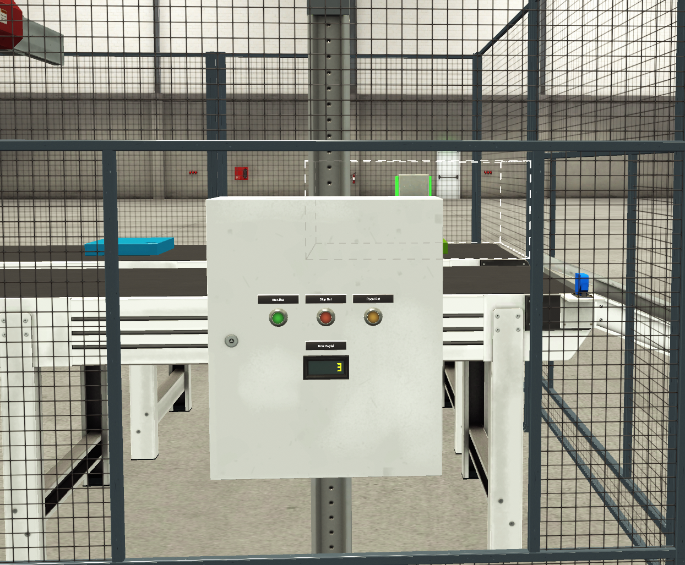

# 🏭 Factory IO & TIA Portal: Pick and Place Automation (State Machine & Ladder Logic)

Bu proje, **Siemens TIA Portal** ve **PLCSim** kullanılarak geliştirilmiş, **Factory IO** simülasyon ortamındaki *Pick and Place* (Al ve Yerleştir) istasyonunu kontrol eden, mühürleme yerine **Set/Reset ve ara hafıza bitleri (%M)** ile kurgulanmış ardışık bir otomasyon projesidir.

---

## ⚙️ Sistem Mantığı ve Çalışma Senaryosu
1. **Sistem Başlatılması:** Start butonuna basıldığında ana hafıza biti Set edilir.
2. **Konveyör 1 ve Parça Algılama:** Parça sensöre ulaştığında konveyör durur ve çakışma önleyici mantıkla Z ekseni aşağı inerek ürünü kavrar.
3. **X Ekseni Transferi:** Tutucu aktif olduktan sonra mekanik gecikmeyle birlikte ürün 2. konveyöre doğru taşınır.
4. **Bırakma ve Geri Dönüş:** İkinci istasyonda parça bırakılır, eksenler başlangıç konumuna döner.
5. **Sayım ve Çıkış:** Anlık sensör düşmelerini engelleyen ara hafıza bitleri yardımıyla parçalar sayılır ve döngü tamamlanır.

---

## 🖥️ Network Adımları ve Görsel Simülasyon

### Network 1 & 2: Sistem Start / Stop ve Ana Hafıza
* **TIA Portal Kodu:**
 
  
* **Factory IO Sahne Görünümü:**
  
> **Açıklama:** Start butonuna (`%I0.0`) basıldığında sistem Set/Reset (SR) bloğu üzerinden ana hafıza bitini (`%M10.0`) aktifler.

---

### Network 3 & 4: Konveyör 1 Hareketi ve Z Ekseni Koordinasyonu
* **TIA Portal Kodu:**

  
* **Factory IO Sahne Görünümü:**
  
> **Açıklama:** Ürün tespit sensörü (`%I0.3`) ürünü gördüğünde Konveyör 1 durur ve Z ekseni çıkışının aynı anda set/reset olmasını engelleyen kapalı kontak mantığıyla Z ekseni aşağı inmeye başlar (`%Q0.4`).

---

### Network 5 & 6: Ürün Tutma ve X Ekseni Transferi
* **TIA Portal Kodu:**
  
  
* **Factory IO Sahne Görünümü:**
  
> **Açıklama:** Tutucu (`%Q0.2`) Set edilip parçayı kavradıktan sonra, zaman rölesi gecikmesiyle X ekseni taşıma hareketi (`%Q0.3`) tetiklenir ve transfer hafızası (`%M10.1`) devreye girer.

---

### Network 7 & 8: Bırakma, Geri Dönüş ve Konveyör 2
* **TIA Portal Kodu:**
  
  
* **Factory IO Sahne Görünümü:**
  
> **Açıklama:** İkinci istasyona varan ürün bırakılır, eksenler evine döner. `Sensor2` ile Konveyör 2 çalıştırılır; anlık sensör kesilmeleri ara hafıza biti (`%M10.2`) ile kararlı hale getirilerek parça sayımı yapılır.

---

### Network 9, 10 & 11: Ürün Sayımı ve Otomatik Durdurma
* **TIA Portal Kodu:**
  
  
* **Factory IO Sahne Görünümü:**
  
> **Açıklama:** `Sensor3` (`%I0.5`) üzerinden anlık düşmeleri engelleyen ara hafıza bitleriyle (`%M10.2`) sayım (`Counter1`) gerçekleştirilir. Ürün sayısı istenen değere (`== 3`) ulaştığında `Sistemi Durdur` biti (`%M10.3`) tetiklenerek Konveyör 2 güvenli bir şekilde durdurulur.

---

## 🛠️ Kullanılan Teknolojiler ve Araçlar
* **PLC Programlama:** Siemens TIA Portal (Ladder Logic - LAD, Set/Reset Mimarisi)
* **Simülasyon Ortamı:** Factory IO & Siemens S7-PLCSim
* **Sürüm Kontrol:** Git & GitHub
